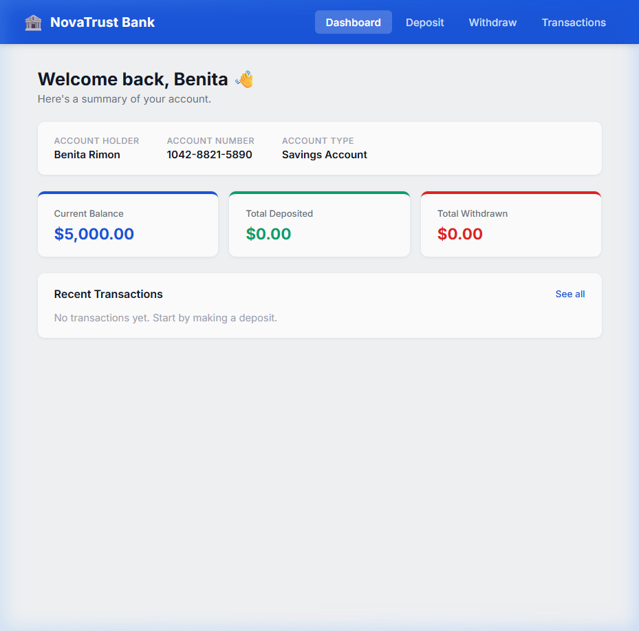
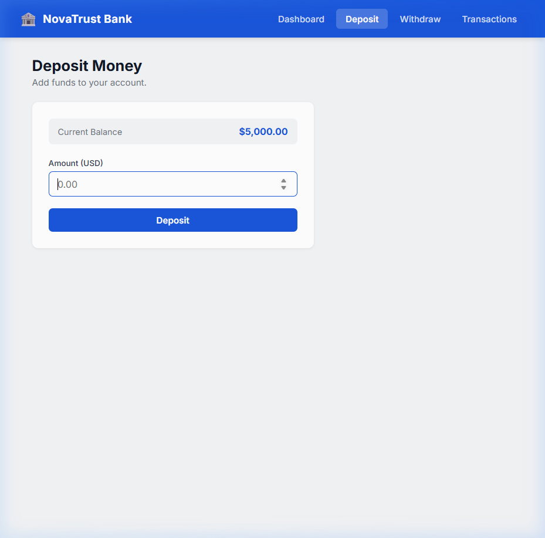
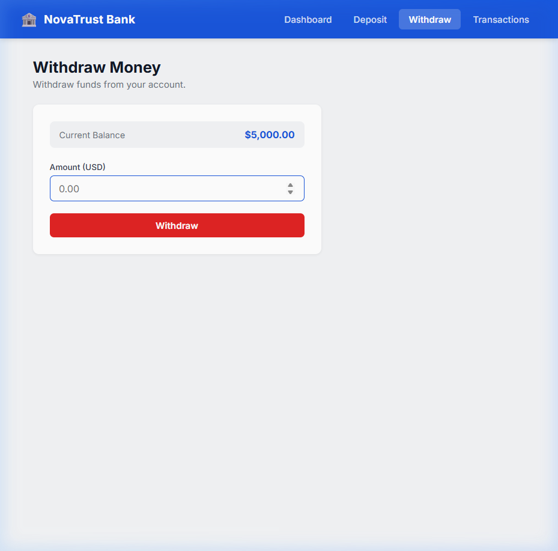
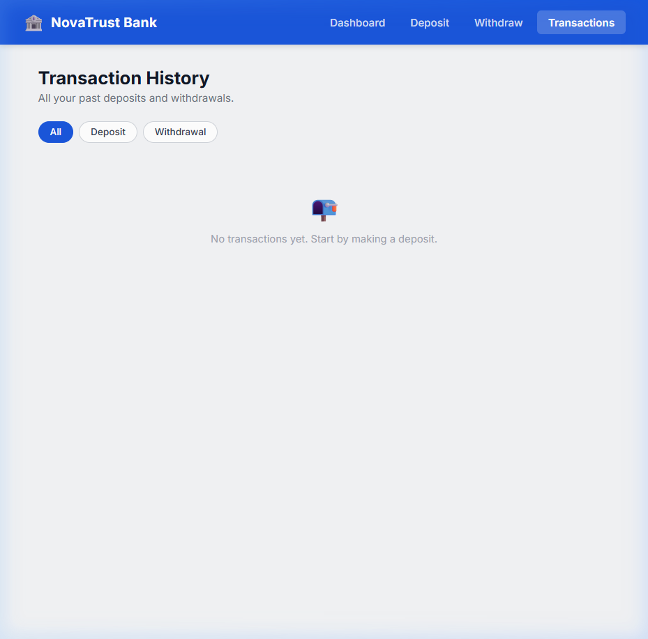

# NovaTrust Bank — Management System

A simple Bank Management System built with **React** and **Vite** as a frontend practice project.

## Screenshots

### Dashboard


### Deposit


### Withdraw


### Transaction History


---

## Features

- View account balance, total deposited, and total withdrawn on a dashboard
- Deposit money with input validation
- Withdraw money with balance check and confirmation prompt
- Full transaction history with filter by type (All / Deposit / Withdrawal)
- Data persists in `localStorage` after page refresh

## Tech Stack

- React (functional components, hooks)
- Vite
- React Router DOM
- Context API
- Vanilla CSS

## Getting Started

```bash
npm install
npm run dev
```

Then open [http://localhost:5173](http://localhost:5173) in your browser.

## Folder Structure

```
src/
├── components/
│   ├── Navbar.jsx
│   ├── Navbar.css
│   ├── BalanceCard.jsx
│   └── TransactionItem.jsx
├── context/
│   └── BankContext.jsx
├── pages/
│   ├── Dashboard.jsx
│   ├── Deposit.jsx
│   ├── Withdraw.jsx
│   └── Transactions.jsx
├── App.jsx
├── main.jsx
└── index.css
```

## Notes

- This is a frontend-only project. No real transactions or backend involved.
- Starting balance is set to $5,000.00 by default (only on first load).
